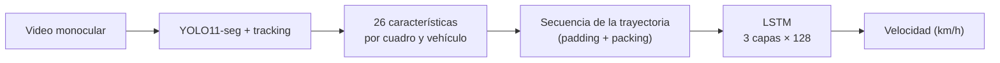

# Estimación de velocidad de vehículos con deep learning

> **English summary.** Vehicle speed estimation from monocular traffic video, with no camera calibration. YOLO11-seg detects, segments and tracks each vehicle; 26 features per frame feed an LSTM (PyTorch Lightning) that regresses its speed. On 18,577 vehicles from the BrnoCompSpeed benchmark it reaches **MAE 1.66 km/h** and **RMSE 3.50 km/h** on a held-out test set. Master's thesis in Artificial Intelligence, Universidad San Francisco de Quito (2025).

Tesis de la Maestría en Inteligencia Artificial de la Universidad San Francisco de Quito (USFQ, 2025). Autores: Vinicio Salcedo y Ramiro Sandoval.

## Problema

Medir la velocidad de un vehículo con una sola cámara suele exigir sensores dedicados o una calibración 3D de la cámara, difícil de escalar. Este proyecto estima la velocidad solo a partir de características 2D del video: el modelo aprende la dinámica del movimiento sin calibrar la cámara.

## Cómo funciona



1. **Procesamiento de video.** Cada video se procesa con el modelo preentrenado `yolo11-seg.pt`. El tracker asocia cajas y máscaras de cada vehículo y se extraen 26 características por cuadro.
2. **Secuencias.** La trayectoria completa de cada vehículo forma una secuencia de longitud variable, que se rellena y empaqueta.
3. **Estimación.** Una LSTM de 3 capas ocultas de 128 unidades, con regularización y early stopping, estima la velocidad.

## Resultados

Los hiperparámetros se eligieron con validación cruzada de 5 pliegues y búsqueda con Optuna. El modelo final se entrenó con el 80 % de los datos y se evaluó en el 20 % restante.

| Métrica | Valor |
|---|---|
| MAE | 1,66 km/h |
| RMSE | 3,50 km/h |
| Exactitud relativa | 97,88 % |
| Vehículos evaluados | 18.577 (el 89,03 % del dataset que se logró emparejar con la verdad de campo) |

## Datos

[BrnoCompSpeed](https://github.com/JakubSochor/BrnoCompSpeed) (Sochor et al., 2018) tiene 18 videos de alta resolución con velocidades medidas. El dataset no se incluye en este repositorio: se solicita a sus autores.

## Flujo de trabajo

Dependencias principales: PyTorch, PyTorch Lightning, torchmetrics, Ultralytics (YOLO), OpenCV, Optuna, scikit-learn, NumPy y pandas.

1. Configura las rutas del dataset y de resultados en `src/dataset/dataset_info.py`.
2. `src/video_process.py` procesa los videos y guarda las características de cada detección.
3. `src/search_fold.py` busca hiperparámetros con validación cruzada.
4. `src/train.py` entrena el modelo final.
5. `src/evaluation/results.ipynb` genera tablas y gráficas de resultados.

## Estructura del proyecto
````
speed-estimation/
├── .gitignore
├── README.md
└── src/
    ├── search_fold.py
    ├── train.py
    ├── video_process.py
    ├── dataset/
    │   ├── tracking_datamodule.py
    │   ├── tracking_dataset.py
    │   └── dataset_info.py
    ├── evaluation/
    │   └── results.ipynb
    ├── models/
    │   └── lstm_model.py
    ├── processing/
    │   ├── process_instance.py
    │   ├── process_video.py
    │   ├── tracker.py
    │   └── video_handler.py
    ├── train/
    │   ├── train_fold.py
    │   └── train_lstm.py
    ├── utils/
    │   └── utils.py
    ├── results/
    ├── ims/
    ├── logs/
    └── lightning_logs/
````
### Descripción de carpetas y archivos

- `.gitignore`: Archivos y carpetas ignorados por git, incluyendo resultados, logs y entornos virtuales.
- `README.md`: Documentación principal del proyecto.
- `src`: Código fuente principal.
  - `search_fold.py`: Script para búsqueda de hiperparámetros del modelo LSTM.
  - `train.py`: Script para entrenar modelos con hiperparámetros definidos.
  - `video_process.py`: Script para procesar los videos del dataset BrnoCompSpeed y generar los archivos con las características de cada detección.
  - `evaluation`: Scripts para evaluación de resultados
    - `results.ipynb`: Notebook para evaluación del código, cargar modelos y generar resultados en dataframe, tablas y gráficas.
  - `train/`: Scripts de entrenamiento.
    - `train_fold.py`: Entrenamiento por fold (validación cruzada).
    - `train_lstm.py`: Entrenamiento general del modelo LSTM.
  - `dataset/`: Manejo y carga de datos del dataset BrnoCompSpeed.
    - `tracking_datamodule.py`: DataModule `TrackingDataModule` para PyTorch Lightning.
    - `tracking_dataset.py`: Definición y utilidades del dataset `TrackingDataset`. Extracción de características y etiquetas. Carga de datos para entrenamiento y validación.
    - `dataset_info.py`: Información de sesiones, rutas y utilidades del dataset.
    - `session_recording.py`: Registro de sesiones y utilidades para el dataset. Datos del ground truth en la clase `SessionRecording`.
  - `models/`: Definición de modelos.
    - `lstm_model.py`: Implementación del modelo `TrackingLSTM` para estimación de velocidad.
  - `processing/`: Scripts de procesamiento de video y tracking.
    - `process_instance.py`: Procesamiento de video con YOLO+Tracking y segmentación de instancias. Funciones para procesar el video y guardar videos procesados y datos json. 
    - `tracker.py`: Implementación del sistema de tracking de vehículos con YOLO y procesamiento de los resultados retornados como bbox y máscaras.
    - `video_handler.py`: Utilidades para manejo y procesamiento de archivos de video. Función process para realizar el proceso de seguimiento, segmentación de instancias, visualización y validación de la detección.
  - `utils/`: Funciones utilitarias y de apoyo.
    - `utils.py`: Funciones auxiliares usadas en distintos módulos del proyecto.
  - `results/`: Resultados de experimentos y validaciones.
  - `ims/`: Imágenes y visualizaciones generadas.
  - `logs/`: Logs de entrenamiento.

## Dependencias principales

- Python 3.10.12
- PyTorch
- PyTorch Lightning
- Optuna

Instalar las dependencias con:

pip install -r requirements.txt

## Uso

1. Configurar las rutas del dataset en `src/dataset/dataset_info.py` si es necesario.
2. Ejecutar los scripts de procesamiento de video, búsqueda de hiperparámetros o entrenamiento desde la carpeta `src/`:
   - Para procesar el video:
     python video_process.py
   - Para búsqueda de hiperparámetros:
     python search_fold.py
   - Para entrenar. Tomar en cuenta que debe cambiar los hiperparámetros directamente en el archivo train.py
     python train.py
3. Los resultados y logs se almacenarán en las carpetas correspondientes dentro de `src/`.
   - Los resultados del procesamiento de video se guardará dentro de la carpeta `src/results`.
   - Los resultados de la optimización de hiperparámetros se guardarán en la carpeta `logs/bayesian_log`
   - Los resultados del entrenamiento se guardarán en la carpeta `logs/test_models`


## Dataset

El proyecto utiliza el dataset BrnoCompSpeed. Para obtener el dataset, comunicarse con Jakub Špaňhel - ispanhel@fit.vutbr.cz.

Posteriormente configurar correctamente las rutas en `dataset_info.py`.

## Créditos

Desarrollado por Vinicio Salcedo.
